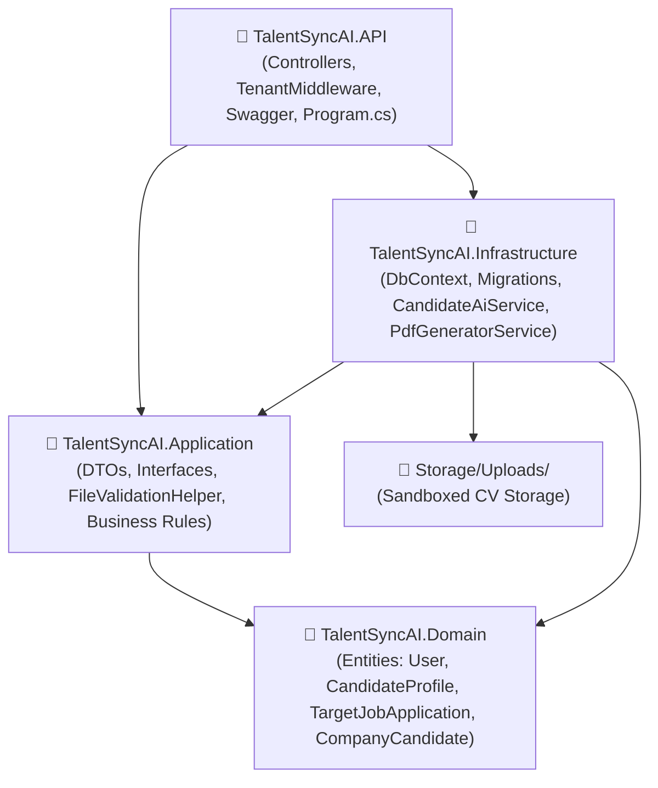

# TalentSyncAI — Backend API (.NET 10)


An enterprise-grade, AI-driven recruitment and career preparation backend platform inspired by **`tam159/next-role`**. Built with **.NET 10**, **Clean Architecture**, and **Entity Framework Core 10**, providing dual-track workflows for independent candidates (B2C) and corporate recruitment teams (B2B).

---

## 🏗️ Architecture Overview

The system strictly follows **Clean Architecture** principles to separate domain models and business rules from infrastructure and presentation concerns:

```
TalentSyncAI-back-end/
├── backend/
│   ├── TalentSyncAI.Domain/          # Core Domain Entities, Enums, Audit & Soft-Delete rules
│   ├── TalentSyncAI.Application/     # CQRS/DTOs, Interfaces, Validation Helpers, Business Logic
│   ├── TalentSyncAI.Infrastructure/  # EF Core DbContext, SQL Server, AI Dual-Mode Client, File Storage, PDF Engine
│   └── TalentSyncAI.API/             # Controllers, Middlewares (Multi-Tenancy), Swagger, Configurations
├── reports/                          # Formal Architecture, AI Integration & Schema Specifications (PDF)
├── TalentSyncAI.sln                  # Visual Studio Solution
└── README.md                         # Documentation
```



---

## 🚀 Core Features

### 1. 🎯 Candidate Career Preparation (B2C — NextRole Style)
* **Secure CV Ingestion:** Validates true file signatures (Magic Bytes for PDF, DOCX, DOC, TXT) and enforces SHA-256 deduplication.
* **Target Job Ingestion:** Accepts job descriptions via raw text, file upload, or URL parsing.
* **AI Job Match & Skill Gap Analysis:** Computes 0–100% match scores, identifies missing competencies, and offers mitigation strategies.
* **Hiring & Company Recon:** Investigates target company tech stacks, culture, interview stages, and killer questions for interviewers.
* **AI-Tailored Resume Engine:** Re-aligns candidate achievements using the **STAR methodology** and ATS-friendly Markdown.
* **Interview Battlecard & Prep Plan:** Generates a 60-second elevator pitch, targeted STAR stories, objection counters, and a day-by-day study schedule.
* **Instant ATS PDF Export:** Dynamically compiles the tailored resume into an ATS-friendly, downloadable PDF.

### 2. 🏢 Private Company Workspace (B2B Recruiter Suite)
* **Multi-Tenant Isolation:** Row-Level tenant scoping ensures zero data leakage between competing companies.
* **Bulk CV Pool Ingestion:** Upload up to 50 CVs per batch with validation, duplicate detection, and detailed ingestion reporting.
* **Natural Language Candidate Search:** Recruiters search candidate pools using natural queries (e.g., *"Senior .NET engineer with microservices in Cairo"*) with match scores and grounded explanations.
* **Candidate Shortlists & Collections:** Organize top candidates into dedicated shortlists with recruiter notes and tags.
* **Immutable Recruiter Audit Trail:** Automatically logs all recruiter actions (uploads, searches, shortlisting) for governance and compliance.

### 3. 🤖 Dual-Mode AI Integration (FastAPI Ready)
* **Zero-Downtime Plug-and-Play:** Configured in `appsettings.json` via `AiService:EnableLiveAi`.
* **Live Mode:** Dispatches asynchronous REST requests to external Python / FastAPI microservices.
* **Fallback / Dev Mode:** Gracefully serves rich, realistic, schema-compliant responses locally if the AI server is offline.

---

## 🔌 API Endpoints Summary

| Category | Method | Endpoint | Description |
| :--- | :---: | :--- | :--- |
| **Auth** | `POST` | `/api/auth/register` | Register Candidate or Recruiter with password complexity check |
| **Auth** | `POST` | `/api/auth/login` | Authenticate and obtain JWT Bearer + Refresh Token |
| **Candidate CV** | `POST` | `/api/candidate/cv/upload` | Upload CV with magic bytes inspection and hash deduplication |
| **Candidate CV** | `GET` | `/api/candidate/cv` | List uploaded CVs and inspect primary CV status |
| **Candidate CV** | `GET` | `/api/candidate/cv/{id}/download` | Download stored original CV |
| **Target Jobs** | `POST` | `/api/candidate/applications` | Create target application via Text, File, or URL |
| **Target Jobs** | `GET` | `/api/candidate/applications` | List applications with AI processing status |
| **Target Jobs** | `GET` | `/api/candidate/applications/{id}` | Get application detail with all AI insights |
| **AI Insights** | `POST` | `/api/candidate/applications/{id}/match` | Run Job Match & Skill Gap Analysis |
| **AI Insights** | `POST` | `/api/candidate/applications/{id}/research` | Run Company & Hiring Recon |
| **AI Insights** | `POST` | `/api/candidate/applications/{id}/tailor-resume` | Generate STAR-formatted tailored resume |
| **AI Insights** | `POST` | `/api/candidate/applications/{id}/interview-prep` | Generate Interview Battlecard & Prep Plan |
| **AI Insights** | `POST` | `/api/candidate/applications/{id}/generate-all` | Execute all 4 AI stages in a single request |
| **Resume Export** | `GET` | `/api/candidate/applications/{id}/tailor-resume/download` | Export tailored resume as a formatted PDF |
| **Company CV** | `POST` | `/api/company/cv/upload` | Bulk upload up to 50 CVs into private pool |
| **Company Search**| `POST` | `/api/company/search` | Natural language candidate search with ranking |
| **Shortlists** | `POST` | `/api/company/shortlists` | Create recruitment shortlist |
| **Shortlists** | `POST` | `/api/company/shortlists/{id}/candidates` | Add candidate to shortlist with recruiter notes |
| **Audit Logs** | `GET` | `/api/company/audit` | View immutable audit history of recruiter actions |

---

## 🛠️ Getting Started

### Prerequisites
* [.NET 10 SDK](https://dotnet.microsoft.com/download/dotnet/10.0)
* [SQL Server (LocalDB, Express, or Docker)](https://www.microsoft.com/sql-server/)

### 1. Clone the repository
```bash
git clone https://github.com/abdoamr99/TalentSync-AI.git
cd TalentSync-AI
```

### 2. Configure Database Connection
Update `backend/TalentSyncAI.API/appsettings.json` with your SQL Server connection string:
```json
"ConnectionStrings": {
  "DefaultConnection": "Server=localhost;Database=TalentSyncAIDb;Trusted_Connection=True;TrustServerCertificate=True;"
}
```

### 3. Apply Migrations & Run
```bash
dotnet restore
dotnet build
dotnet run --project backend/TalentSyncAI.API --launch-profile http
```

### 4. Open Swagger UI
Navigate to:
👉 **`http://localhost:5239/swagger`**

---

## 📚 Documentation & Deliverables

Comprehensive specifications and integration blueprints are located in the [`reports/`](./reports) directory:
* **`TalentSyncAI_Complete_Candidate_Lifecycle_and_AI_Guide.pdf`** — Full end-to-end candidate lifecycle and AI protocol guide.
* **`TalentSyncAI_API_Endpoints_and_Architecture_Guide.pdf`** — Complete technical reference for all endpoints and file mappings.
* **`TalentSyncAI_Backend_AI_Integration_Simple.pdf`** — Direct AI integration reference for the Python/FastAPI team.
* **`TalentSyncAI_Candidate_AI_Backend_Schemas.pdf`** — JSON Schemas and data contracts specification.

---

## 📄 License
This project is licensed under the MIT License.
