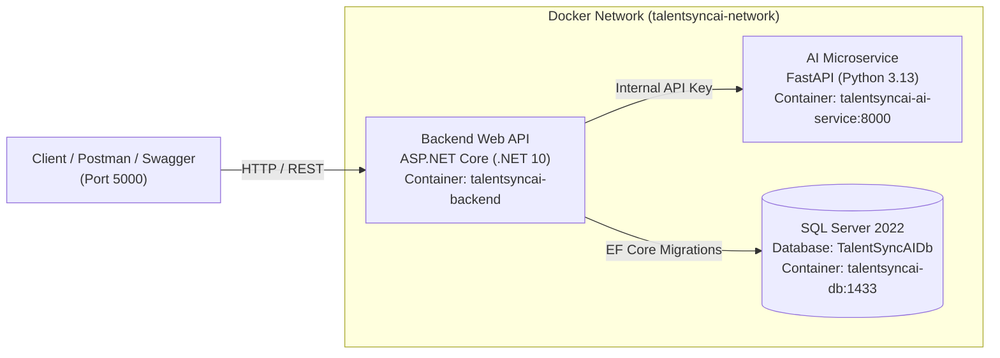

# TalentSyncAI — Enterprise AI Recruitment Platform


An enterprise-grade, AI-driven recruitment and career preparation platform. Built with **ASP.NET Core (.NET 10)** following **Clean Architecture**, integrated with a stateless **Python / FastAPI AI Microservice**, and fully containerized with **Docker & Docker Compose**.

Provides dual-track workflows for:
1. **Candidates (B2C):** AI-powered job matching, target company research, resume tailoring, and interview prep kits with instant ATS PDF export.
2. **Recruiters (B2B):** Multi-tenant company workspaces, natural language candidate search, shortlists with hiring pipeline tracking, private CV bank, and immutable audit logs.

---

## 🏗️ Architecture Overview

The system is organized as a unified monorepo:

```text
TalentSync-AI/
├── backend/                       # ASP.NET Core Web API (.NET 10)
│   ├── TalentSyncAI.API/          # HTTP Controllers, Middlewares, Auth, Swagger
│   ├── TalentSyncAI.Application/  # DTOs, Interfaces, Validation, Business Logic
│   ├── TalentSyncAI.Domain/       # Domain Entities, Rules, Enums
│   ├── TalentSyncAI.Infrastructure/ # EF Core DbContext, AI Client, File Storage, PDF
│   └── Dockerfile                 # Multi-stage .NET 10 container build
├── ai-service/                    # Python / FastAPI AI Microservice
│   ├── app/
│   │   ├── candidate/             # AI match, research, tailor, prep endpoints
│   │   ├── core/                  # LLM config, security, prompt templates
│   │   └── main.py                # FastAPI app entry point
│   ├── pyproject.toml             # Python dependencies
│   └── Dockerfile                 # Python 3.13 container build
├── docker-compose.yml             # Full stack orchestration (DB + AI + Backend)
├── .env.example                   # Environment configuration template
├── TalentSyncAI.sln               # Solution file
└── README.md                      # Documentation
```



---

## ⚡ Quick Start with Docker (Recommended for Team)

You can run the entire platform (Database + AI Service + Backend) with a **single command**. No need to manually configure SQL Server or Python environments!

### 1. Prerequisites
- [Docker Desktop](https://www.docker.com/products/docker-desktop/) installed and running.
- [Git](https://git-scm.com/) installed.

### 2. Clone the Repository
```bash
git clone -b backend-dev https://github.com/abdoamr99/TalentSync-AI.git
cd TalentSync-AI
```

### 3. (Optional) Configure Environment
If you want to use live LLMs (OpenAI, Tavily), copy `.env.example` to `.env` and fill in your keys:
```bash
cp .env.example .env
```
*(If no keys are provided, the platform automatically runs in its built-in **Fail-Safe Mock Engine** mode).*

### 4. Run Everything
```bash
docker compose up --build
```

That's it! Docker will:
1. Start **SQL Server 2022** and wait until it's healthy.
2. Start the **FastAPI AI Microservice** on port `8000`.
3. Start the **ASP.NET Core Backend** on port `5000`.
4. Automatically apply all database migrations on startup.

---

## 🌐 Service Access & URLs

| Service | URL | Description |
| :--- | :--- | :--- |
| **Backend Swagger UI** | **`http://localhost:5000/swagger`** | Interactive API documentation & testing |
| **AI Service Health** | **`http://localhost:8000/`** | FastAPI liveness status (`HEALTHY`) |
| **AI Service Docs** | **`http://localhost:8000/docs`** | FastAPI OpenAPI / Swagger UI |
| **SQL Server** | **`localhost:1433`** | User: `sa` / Password: `YourStrong@Passw0rd!` |

---

## 🛠️ Common Docker Commands

* **Run in background (detached):**
  ```bash
  docker compose up -d
  ```

* **View live logs:**
  ```bash
  docker compose logs -f
  # Or for a specific service:
  docker compose logs -f backend
  docker compose logs -f ai-service
  ```

* **Stop all services:**
  ```bash
  docker compose down
  ```

* **Stop and remove all volumes (fresh start):**
  ```bash
  docker compose down -v
  ```

---

## 🔌 Core API Endpoints Summary

| Category | Method | Endpoint | Description |
| :--- | :---: | :--- | :--- |
| **Auth** | `POST` | `/api/auth/register` | Register Candidate or Recruiter with password hashing |
| **Auth** | `POST` | `/api/auth/login` | Authenticate and obtain JWT Bearer Token |
| **Candidate CV** | `POST` | `/api/candidate/cv/upload` | Upload CV with signature validation and deduplication |
| **Candidate CV** | `GET` | `/api/candidate/cv` | List uploaded CVs |
| **Candidate CV** | `GET` | `/api/candidate/cv/{id}/download` | Download stored original CV |
| **Target Jobs** | `POST` | `/api/candidate/applications` | Create target application via Text, File, or URL |
| **Target Jobs** | `GET` | `/api/candidate/applications` | List applications with AI processing status |
| **AI Insights** | `POST` | `/api/candidate/applications/{id}/match` | Run Job Match & Skill Gap Analysis |
| **AI Insights** | `POST` | `/api/candidate/applications/{id}/research` | Run Company & Hiring Recon |
| **AI Insights** | `POST` | `/api/candidate/applications/{id}/tailor-resume` | Generate STAR-formatted tailored resume |
| **AI Insights** | `POST` | `/api/candidate/applications/{id}/interview-prep` | Generate Interview Battlecard & Prep Plan |
| **Resume Export** | `GET` | `/api/candidate/applications/{id}/tailor-resume/download` | Export tailored resume as a formatted PDF |
| **Company Search**| `POST` | `/api/company/search` | Natural language candidate search with ranking |
| **Shortlists** | `POST` | `/api/company/shortlists` | Create recruitment shortlist |
| **Shortlists** | `POST` | `/api/company/shortlists/{id}/candidates` | Add candidate to shortlist with notes |
| **Audit Logs** | `GET` | `/api/company/audit` | View immutable audit history of recruiter actions |

---

## 💻 Manual Local Development (Without Docker)

If you prefer to run services directly on your host machine:

### 1. Run AI Service (FastAPI)
```bash
cd ai-service
py -3.14 -m venv venv
.\venv\Scripts\activate
pip install -e .
uvicorn app.main:app --reload --port 8000
```

### 2. Run Backend (.NET 10)
```bash
cd backend/TalentSyncAI.API
dotnet run
```
Navigate to `http://localhost:5239/swagger` or `http://localhost:5000/swagger`.

---

## 📄 License
This project is licensed under the MIT License.
